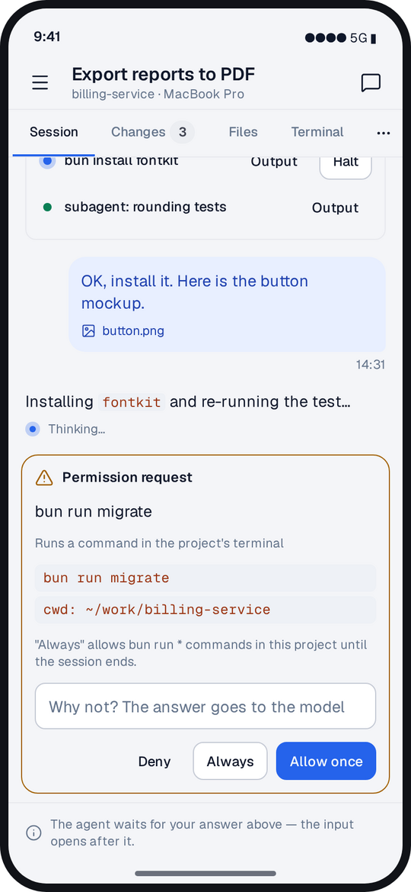
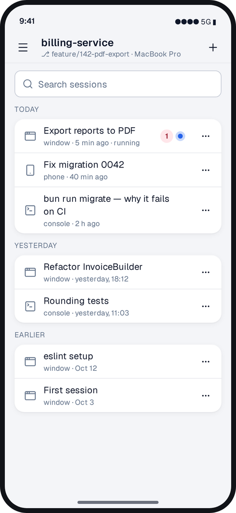
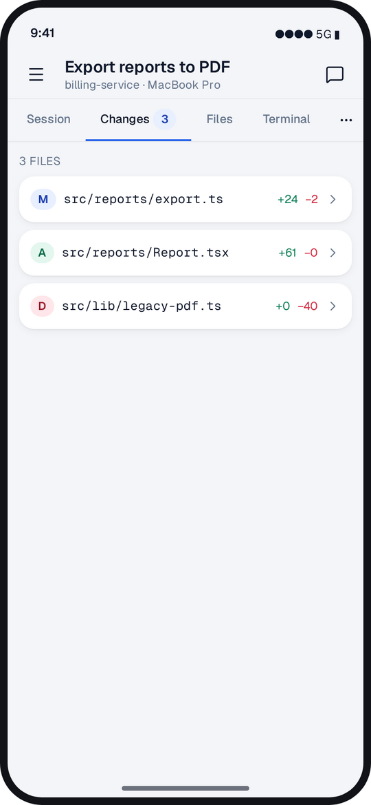
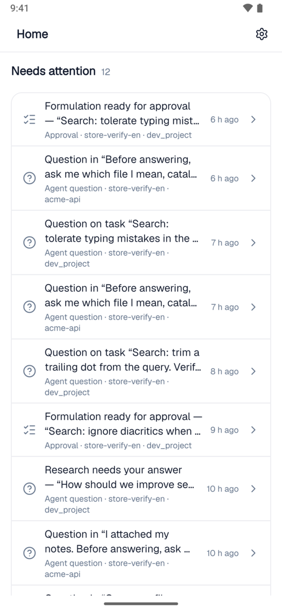
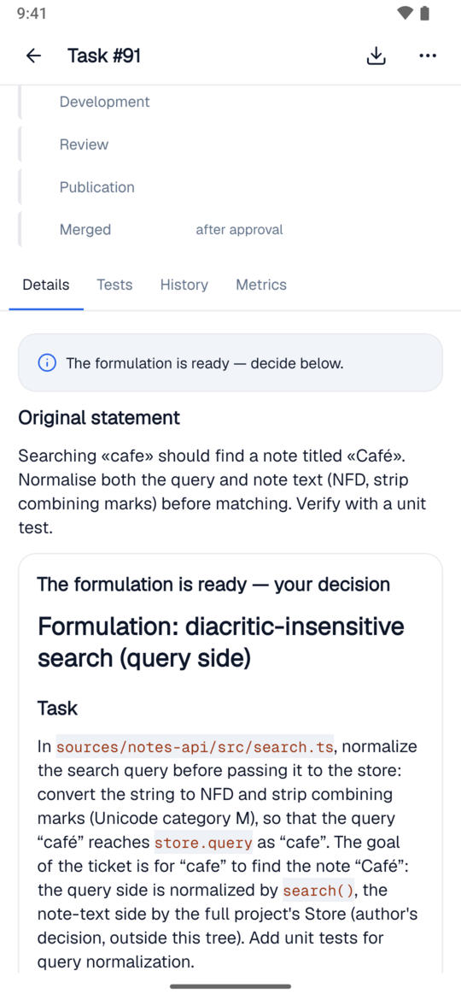
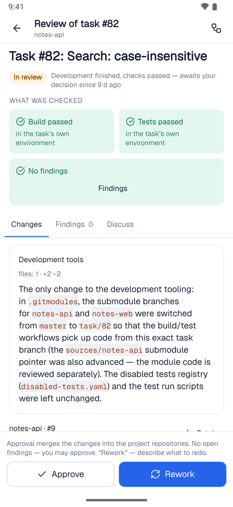

  <picture>
    <source media="(prefers-color-scheme: dark)" srcset="assets/logo-dark.svg">
    
  </picture>

  <b>Buff Code and Buff on your phone: run the agent sessions on your own computer and make the decisions on your team's tasks.</b> 
  An app for iPhone and Android. Free, no sign-up, no purchases.

  
  

  <a href="#where-to-get-it">Where to get it</a> ·
  <a href="#what-it-does">What it does</a> ·
  <a href="#how-to-connect">How to connect</a> ·
  <a href="docs/ios-install.en.md">Installing on iPhone</a> ·
  <a href="https://buff.systems/en/docs/mobile">Documentation</a> ·
  <a href="README.md">Русский</a>

---

The Buff Code agent works on your computer and stops now and then: it asks to allow a command, asks a question, offers a choice. The app brings those moments to your phone — you answer and it carries on while you are away from the desk. It works the same way with your company's Buff: approve a task, answer the analyst, approve a change.

  
  
  

This repository holds the app builds and the installation guides. The files of every version are in the [releases](https://github.com/buffsystems/buff-mobile/releases).

## Where to get it

| Phone   | Where                                                                                                                                                                                                                    |
| ------- | ------------------------------------------------------------------------------------------------------------------------------------------------------------------------------------------------------------------------ |
| Android | [RuStore](https://www.rustore.ru/catalog/app/systems.buff.app), or the `buff-<version>.apk` file from the [latest release](https://github.com/buffsystems/buff-mobile/releases/latest). Google Play is coming.           |
| iPhone  | The `buff-v<version>.ipa` file from the [latest release](https://github.com/buffsystems/buff-mobile/releases/latest), installed with Sideloadly — [step-by-step guide](docs/ios-install.en.md). The App Store is coming. |

The current store links are at [buff.systems/en/mobile](https://buff.systems/en/mobile). Every file in a release has its `.sha256` checksum next to it.

**Installing the APK on Android.** Download `buff-<version>.apk` to the phone and open the file. Android asks to allow installs from that source (the browser or Files) — allow it and tap "Install". An update installs the same way, over the previous version.

**Installing on iPhone.** Until the app is in the App Store, the `.ipa` file is installed from a computer over a cable: [step-by-step guide](docs/ios-install.en.md).

## What it does

### Buff Code from your phone

- **The agent does not wait for you at the computer.** It stopped and asks to allow a command, answer a question or pick an option — reply from the phone and it continues.
- **A new session on the go.** Pick the project and the model, describe the job, attach a file or a photo — the agent starts working on your computer.
- **You see what it is doing.** The session, the code changes, the files and the terminal are on the phone screen. A long run can be interrupted.
- **A notification when it needs you.** The agent waits for permission or has finished — the app tells you, and a tap opens the right session.
- **No Buff account needed.** Buff Code on the computer is enough: Settings → Phone in the window, or `/phone` in the console. It works with your own model too.

### Your company's Buff

- **Approve a task in a minute.** The analyst turns a request into a precise statement: what changes, where, and how it will be verified. Approve it on the way or send it back with a remark. Answer the analyst's question with a tap, in your own words, with a photo or a file.
- **Review without a laptop.** What was done, what passed the checks, where the doubts are. Approve the change, return it for rework or discuss a specific remark.
- **Ask the project.** A question about the code and the documents — an answer with links to its sources. Deep research, the knowledge base, audits and repository status are the same as in the web cabinet.

  
  
  

### All in one app

- **One "Needs attention" screen.** Every decision waiting for you, in one list: from Buff Code on your machines, from your organisation on buff.systems and from your company's servers. An empty list means the agents are working and you are free.
- **Notifications you choose.** Which events you receive, you decide per connection.
- **Works offline.** On the subway or on a plane the screens open with what the app saw last and show the moment that state is from.
- **Dark and light themes, Russian and English.**

## What it works with

| Connects to                     | How                                                                | More                                                                         |
| ------------------------------- | ------------------------------------------------------------------ | ---------------------------------------------------------------------------- |
| Buff Code on your machine       | Settings → Phone in the window, or `/phone` in the console         | [Pairing with Buff Code](https://buff.systems/en/docs/mobile/pair-buff-code) |
| An organisation on buff.systems | A QR code, or a link and a code, in the cabinet's Settings → Phone | [Pairing with the cabinet](https://buff.systems/en/docs/mobile/pair-cabinet) |
| Buff Community and Enterprise   | The same, from your installation's cabinet                         | [Pairing with the cabinet](https://buff.systems/en/docs/mobile/pair-cabinet) |

One app holds several connections at once: your own machines with Buff Code, organisations and company installations.

## How to connect

1. Install the app — from a store or from the [release](https://github.com/buffsystems/buff-mobile/releases/latest).
2. On the computer, open Buff Code or your organisation's cabinet and choose Settings → Phone.
3. Scan the QR code with the app — or open the link and compare the six digits on both screens.

The app needs no sign-up. Want a look first? The first screen has a demo with real sessions, tasks and reviews.

## Security

- **End-to-end encryption.** The phone and your computer or installation encrypt every message with keys only they hold. The buff.systems gateway relays the envelopes and cannot open them — notification text included.
- **Pairing is confirmed on the computer:** a QR code or a six-digit check.
- **The phone gets the rights of the person who paired it.** No passwords live on the phone.
- **A lost phone is disconnected in a minute** — in Buff Code or in the cabinet. In a company the administrator decides who may pair phones.
- **The computer or the installation only needs outbound access to buff.systems:** no ports have to be opened to the outside.

[Privacy policy](https://buff.systems/en/legal/mobile-privacy) · [Third-party licences](https://buff.systems/en/mobile/licenses)

## Other Buff products

- [buff-code](https://github.com/buffsystems/buff-code) — Buff Code: an AI coding agent for the terminal and desktop.
- [buff-community](https://github.com/buffsystems/buff-community) — Buff Community Edition: an AI developer, analyst and knowledge base on your machine, with your model.
- [buff-connector](https://github.com/buffsystems/buff-connector) — the connector: agents work with your code and trackers while the data stays inside your perimeter.
- [buff-guardrails](https://github.com/buffsystems/buff-guardrails) — an AI gateway that strips personal data and secrets from requests.

## Questions and bugs

Write to [this repository's issues](https://github.com/buffsystems/buff-mobile/issues) or to [buff.systems/en/contact](https://buff.systems/en/contact). Name the app version (Settings → bottom of the screen) and the phone model.
