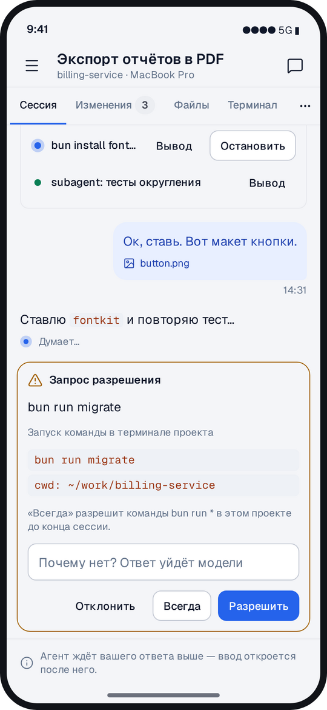
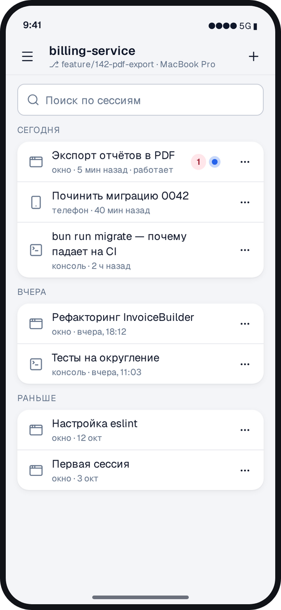
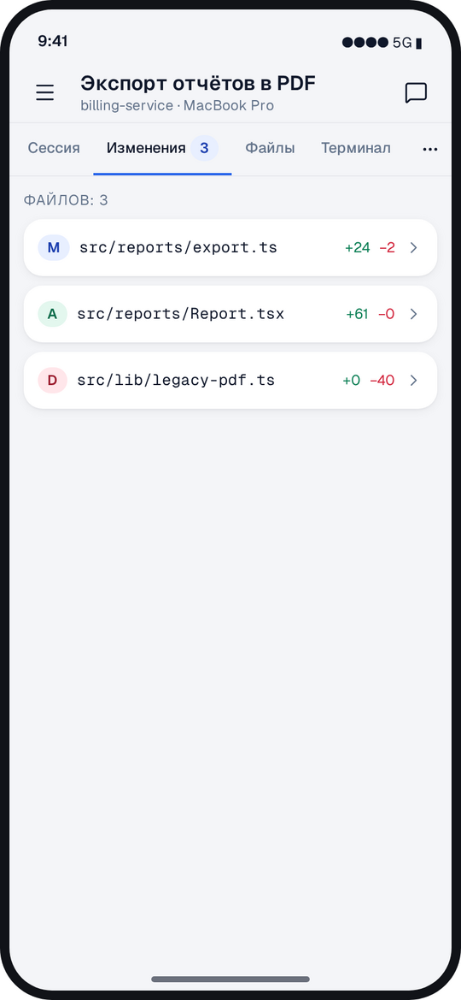
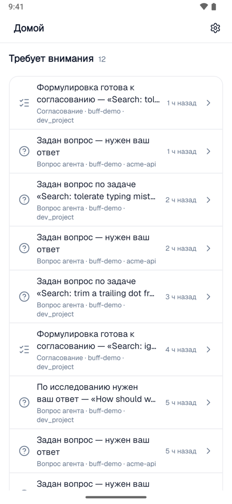
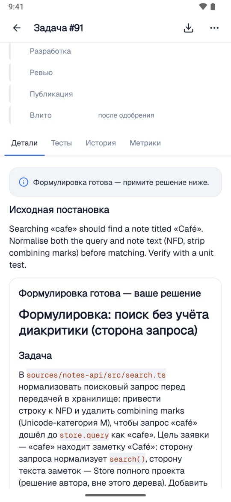
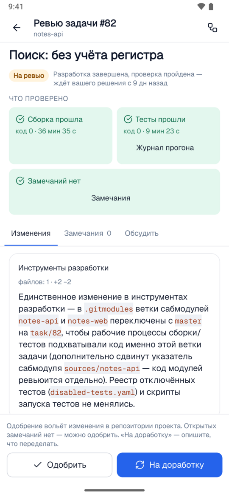

  <picture>
    <source media="(prefers-color-scheme: dark)" srcset="assets/logo-dark.svg">
    
  </picture>

  <b>Buff Code и Buff на телефоне: ведите сессии агента на своём компьютере и принимайте решения по задачам команды.</b> 
  Приложение для iPhone и Android. Бесплатно, без регистрации и покупок.

  
  

  <a href="#где-скачать">Где скачать</a> ·
  <a href="#возможности">Возможности</a> ·
  <a href="#как-подключить">Как подключить</a> ·
  <a href="docs/ios-install.md">Установка на iPhone</a> ·
  <a href="https://buff.systems/docs/mobile">Документация</a> ·
  <a href="README.en.md">English</a>

---

Агент Buff Code работает на вашем компьютере и время от времени останавливается: просит разрешить команду, задаёт вопрос, предлагает выбрать вариант. Приложение приносит эти моменты на телефон — вы отвечаете, и он продолжает, пока вы не за столом. Так же оно работает с Buff вашей компании: согласовать задачу, ответить аналитику, одобрить изменение.

  
  
  

В этом репозитории — сборки приложения и инструкции по установке. Файлы каждой версии лежат в [выпусках](https://github.com/buffsystems/buff-mobile/releases).

## Где скачать

| Телефон | Откуда                                                                                                                                                                                                    |
| ------- | --------------------------------------------------------------------------------------------------------------------------------------------------------------------------------------------------------- |
| Android | [RuStore](https://www.rustore.ru/catalog/app/systems.buff.app) или файл `buff-<версия>.apk` из [последнего выпуска](https://github.com/buffsystems/buff-mobile/releases/latest). Google Play — скоро.     |
| iPhone  | Файл `buff-v<версия>.ipa` из [последнего выпуска](https://github.com/buffsystems/buff-mobile/releases/latest), ставится через Sideloadly — [инструкция по шагам](docs/ios-install.md). App Store — скоро. |

Действующие ссылки на магазины — на [buff.systems/mobile](https://buff.systems/mobile). Рядом с каждым файлом в выпуске лежит его контрольная сумма `.sha256`.

**Установка APK на Android.** Скачайте `buff-<версия>.apk` на телефон и откройте файл. Android попросит разрешить установку из этого источника (браузера или «Файлов») — разрешите и нажмите «Установить». Обновление ставится так же, поверх прежней версии.

**Установка на iPhone.** Пока приложения нет в App Store, файл `.ipa` ставится с компьютера по кабелю: [инструкция по шагам](docs/ios-install.md).

## Возможности

### Buff Code с телефона

- **Агент не ждёт вас у компьютера.** Он остановился и просит разрешить команду, ответить на вопрос или выбрать вариант — ответьте с телефона, и он продолжит.
- **Новая сессия по дороге.** Выберите проект и модель, опишите задачу, приложите файл или фото — агент начнёт работу на вашем компьютере.
- **Видно, что он делает.** Ход сессии, изменения в коде, файлы и терминал — на экране телефона. Долгий ход можно прервать.
- **Уведомление, когда нужны вы.** Агент ждёт разрешения или закончил — приложение сообщит, а касание откроет нужную сессию.
- **Учётная запись Buff не нужна.** Достаточно Buff Code на компьютере: «Настройки → Телефон» в окне или `/phone` в консоли. Работает и с вашей собственной моделью.

### Buff вашей компании

- **Согласовать задачу за минуту.** Аналитик разбирает заявку и приносит точную формулировку: что меняем, где и как проверим. Согласуйте её в пути или верните с замечанием. На вопрос аналитика отвечайте касанием, своими словами, фото или файлом.
- **Ревью без ноутбука.** Что сделано, что прошло проверки, где сомнения. Одобрите изменение, отправьте на доработку или обсудите конкретное замечание.
- **Спросить проект.** Вопрос по коду и документам — ответ со ссылками на источники. Глубокие исследования, база знаний, аудиты и состояние репозиториев — те же, что в кабинете.

  
  
  

### Всё в одном приложении

- **Один экран «Требует внимания».** Все решения, которые ждут именно вас, — в одном списке: из Buff Code на ваших машинах, из организации на buff.systems и с серверов компании. Пустой список значит, что агенты работают, а вы свободны.
- **Уведомления по выбору.** Какие события получать, вы решаете для каждого подключения.
- **Работает без сети.** В метро и в самолёте экраны открываются с тем, что приложение видело в последний раз, и показывают, на какой момент это состояние.
- **Тёмная и светлая тема, русский и английский.**

## С чем работает

| Куда подключается           | Как                                                      | Подробнее                                                                  |
| --------------------------- | -------------------------------------------------------- | -------------------------------------------------------------------------- |
| Buff Code на вашей машине   | «Настройки → Телефон» в окне или `/phone` в консоли      | [Подключение к Buff Code](https://buff.systems/docs/mobile/pair-buff-code) |
| Организация на buff.systems | QR-код или ссылка и код в «Настройки → Телефон» кабинета | [Подключение к кабинету](https://buff.systems/docs/mobile/pair-cabinet)    |
| Buff Community и Enterprise | Так же, из кабинета вашей установки                      | [Подключение к кабинету](https://buff.systems/docs/mobile/pair-cabinet)    |

Одно приложение держит несколько подключений сразу: свои машины с Buff Code, организации и установки компании.

## Как подключить

1. Установите приложение — из магазина или из [выпуска](https://github.com/buffsystems/buff-mobile/releases/latest).
2. На компьютере откройте Buff Code или кабинет организации и выберите «Настройки → Телефон».
3. Отсканируйте QR-код приложением — или откройте ссылку и сверьте шесть цифр на обоих экранах.

Регистрация в приложении не нужна. Хотите сначала посмотреть — на первом экране есть демо с настоящими сессиями, задачами и ревью.

## Безопасность

- **Сквозное шифрование.** Телефон и ваш компьютер или установка шифруют каждое сообщение ключами, которые есть только у них. Шлюз buff.systems передаёт конверты и открыть их не может — включая текст уведомлений.
- **Подключение подтверждается на компьютере:** QR-код или сверка шести цифр.
- **Телефон получает права того, кто его подключил.** Паролей на телефоне нет.
- **Потерянный телефон отключается за минуту** — в Buff Code или в кабинете. В компании администратор решает, кому разрешено подключать телефоны.
- **Компьютеру и установке нужен только исходящий доступ к buff.systems:** открывать порты наружу не требуется.

[Политика конфиденциальности](https://buff.systems/legal/mobile-privacy) · [Лицензии сторонних компонентов](https://buff.systems/mobile/licenses)

## Другие продукты Buff

- [buff-code](https://github.com/buffsystems/buff-code) — Buff Code: среда разработки для инженеров, консоль и приложение.
- [buff-community](https://github.com/buffsystems/buff-community) — Buff Community Edition: ИИ-разработчик, аналитик и база знаний на вашей машине, с вашей моделью.
- [buff-connector](https://github.com/buffsystems/buff-connector) — коннектор: агенты работают с вашим кодом и трекерами, а данные остаются в вашем периметре.
- [buff-guardrails](https://github.com/buffsystems/buff-guardrails) — шлюз к ИИ-моделям, который убирает персональные данные и секреты из запросов.

## Вопросы и ошибки

Пишите в [issues этого репозитория](https://github.com/buffsystems/buff-mobile/issues) или на [buff.systems/contact](https://buff.systems/contact). Укажите версию приложения («Настройки» → внизу экрана) и модель телефона.
